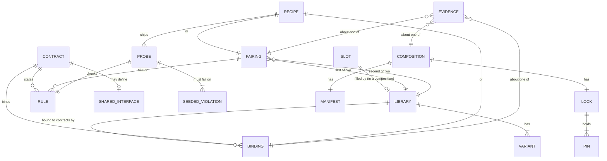
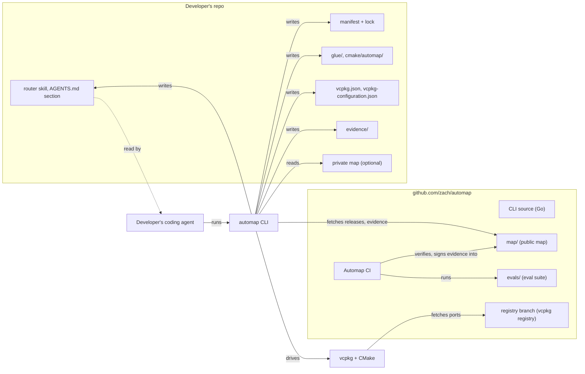

# Automap specification

Automap is an agent-ready map and CLI for composing custom C++ game engines from libraries. A developer's coding agent uses it to add a library to an engine, with seam glue the developer owns and signed evidence that the result works.

This spec is what the build team works from. It restates decisions recorded in the ADRs ([ADR-0001](../adr/0001-primary-persona-framework-first-indie.md) to [ADR-0082](../adr/0082-evidence-is-read-live-for-exact-pins.md)) and uses the terms defined in [`CONTEXT.md`](../../CONTEXT.md). The JSON Schemas in [`schemas/`](../../schemas/) and the examples in [`examples/`](examples/) are part of the spec; [`check-examples.py`](check-examples.py) validates every example against its schema and against the rules the schemas can't express. Where this spec fills in a detail no ADR decided, such as a command name or a file path, the detail is listed in §12.3.

## Contents

1. [Problem, users and jobs](#1-problem-users-and-jobs)
2. [Product overview and journeys](#2-product-overview-and-journeys)
3. [Domain model](#3-domain-model)
4. [Data formats](#4-data-formats)
5. [Architecture](#5-architecture)
6. [Verification and trust](#6-verification-and-trust)
7. [Extensibility](#7-extensibility)
8. [Content plan for v1](#8-content-plan-for-v1)
9. [Operations](#9-operations)
10. [Agent-driven development plan](#10-agent-driven-development-plan)
11. [Milestones and the first three slices](#11-milestones-and-the-first-three-slices)
12. [Risks, open questions and ADR index](#12-risks-open-questions-and-adr-index)

---

## 1. Problem, users and jobs

### 1.1 Problem

Every C++ library in a game engine brings its own allocator hooks, job model, math types, handle layout, init order, error hooks and ABI-affecting defines. No two of the libraries the research profiled share a vector type, and their schedulers assume different semantics (Jolt's jobs and barriers, Box2D's enqueue and finish, flecs's task threads) ([02c](../research/02c-catalog-simulation-runtime-glue.md), verified 2026-10-29). Package managers fetch and build libraries and encode build-level fit, but none can express these seams ([01](../research/01-package-managers.md)). Ecosystems that compose well have one core that owns the seams, such as Bevy's plugin lifecycle or Godot's initialization levels ([03](../research/03-prior-art.md)); C++ has none. Managing third-party libraries is C++ developers' top pain, with about 47% calling it major ([05](../research/05-developer-needs-2026.md)).

Coding agents can write the glue, but nothing tells them what the glue must satisfy or proves that it does. No ecosystem publishes "A works with B" as evidence: vcpkg checks that ports build, ConanCenter calls itself "not a testing service", and links to CI runs disappear after 90 days ([06](../research/06-verification.md)). Developers trust agent output when they can check it ([05](../research/05-developer-needs-2026.md)).

Automap is the missing core, delivered as data and glue source rather than a runtime: one contract per seam, recipes that bind each library to the contracts, and evidence that the resulting composition passes executable probes.

### 1.2 Users

- **Primary persona: the framework-first indie** [ADR-0001](../adr/0001-primary-persona-framework-first-indie.md). A solo developer or small team who builds and ships games on their own engine assembled from libraries. Their coding agent is the primary steward of the engine's code and the human sets direction; reading the C++ is optional [ADR-0005](../adr/0005-agent-is-primary-steward.md). Agent-only builders are part of this persona [ADR-0004](../adr/0004-v1-non-goals.md).
- **Served, not designed around:** jam developers and learners, through testbeds as an on-ramp.
- **Designed for, not primary in v1:** console-bound studios. Private maps must work for them [ADR-0047](../adr/0047-private-maps.md).

### 1.3 Jobs to be done

| Job | Statement | v1 |
| --- | --- | --- |
| **Extend** (core) | Add a library to my engine, with seam glue I own and evidence that the pairing works [ADR-0002](../adr/0002-core-job-is-extend.md). | yes |
| **Start** | The first instance of extend: begin a composition from nothing. | yes |
| **Upgrade** | Move my engine to newer library versions and a newer map release. | yes |
| **Adopt** | Bring my existing hand-built engine under Automap; a design constraint from v1, shipped after the new-engine path [ADR-0003](../adr/0003-adopting-existing-engines-is-a-design-constraint.md). | yes |
| **Eject** | Leave Automap with a plain CMake and vcpkg project that still builds [ADR-0040](../adr/0040-eject-is-one-cli-step.md). | yes |
| Audit | Report licenses and risks across the composition, beyond extend-time warnings. | after v1 [ADR-0059](../adr/0059-v1-jobs.md) |
| Port | Add a new platform. | after v1 [ADR-0059](../adr/0059-v1-jobs.md) |

The day-one minimum is start, then extend once [ADR-0010](../adr/0010-day-one-minimum-start-then-extend-once.md).

### 1.4 Non-goals

- Godot and LibGodot extenders, and consumers in languages other than C++ [ADR-0004](../adr/0004-v1-non-goals.md).
- A runtime dependency: nothing from Automap is linked into the engine [ADR-0008](../adr/0008-no-automap-runtime-dependency.md).
- A maintenance agent: upgrades are run by the developer's own agent or CI [ADR-0009](../adr/0009-no-automap-maintenance-agent.md).
- Telemetry [ADR-0062](../adr/0062-no-telemetry-eval-suite-measures-success.md), an MCP server [ADR-0045](../adr/0045-no-mcp-server-in-v1.md), and commercial services [ADR-0054](../adr/0054-open-source-non-commercial.md).
- Web and console platforms in Automap's own CI; a web-capable testbed is deferred past v1 [ADR-0056](../adr/0056-v1-platforms-desktop-only.md).
- Engine-facing slot APIs: the engine calls each library's own API [ADR-0012](../adr/0012-slots-have-no-automap-api.md).

---

## 2. Product overview and journeys

### 2.1 What Automap is

Automap is three things [ADR-0006](../adr/0006-product-shape-map-cli-router-skill.md):

1. **The map:** versioned data describing slots, libraries, contracts and recipes, plus the evidence behind them. It ships as immutable, dated map releases [ADR-0053](../adr/0053-map-releases-are-immutable-and-recorded-in-locks.md).
2. **The CLI:** the one deterministic way to query the map and act on a composition. It resolves, writes glue, checks contracts and runs verification, with JSON output and stable failure codes for agents [ADR-0041](../adr/0041-cli-json-output-and-failure-codes.md).
3. **The router skill:** one agent skill, shipped inside the CLI, that teaches agents to drive the CLI [ADR-0044](../adr/0044-router-skill-ships-inside-the-cli.md).

Behind them sit the **Automap registry**, a vcpkg registry of overlay ports [ADR-0034](../adr/0034-vcpkg-is-the-v1-build-backend.md); **Automap's CI**, which produces the map's evidence [ADR-0033](../adr/0033-automap-ci-verifies-declared-edges-latest-and-previous.md); and the **eval suite**, which measures success [ADR-0062](../adr/0062-no-telemetry-eval-suite-measures-success.md).

Automap sits above vcpkg, which acts as its build backend [ADR-0007](../adr/0007-automap-sits-above-build-backends.md). Everything Automap writes into a developer's repo is ordinary source and build files the developer owns.

### 2.2 No tiers

Automap has no tiers [ADR-0018](../adr/0018-no-tiers-in-the-domain-model.md) and no layers [ADR-0019](../adr/0019-no-layers-in-the-domain-model.md). A composition is whatever slots the developer fills. The testbed, the starter engine and the custom integration are the three worked journeys below [ADR-0060](../adr/0060-three-worked-journeys.md); together they cover every v1 job.

### 2.3 What the developer's repo holds

After `automap start`, a composition's repo contains (paths are defaults; the manifest records where glue lives):

```
automap.manifest.json      the composition; the agent edits it
automap.lock.json          exact pins; only the CLI writes it
vcpkg.json                 written by the CLI, committed
vcpkg-configuration.json   registries: vcpkg's curated one, the Automap registry, private ones
CMakeLists.txt             the developer's; includes cmake/automap/automap.cmake once (start writes it,
                           with main.cpp, from the map's testbed template when the repo has no CMake project)
cmake/automap/             one build fragment per library, plus automap.cmake
glue/automap/              shared interfaces, the probe harness, choices.h, the startup
glue/<library>/            bindings and setup glue for one library
glue/<a>--<b>/             glue for one pairing
evidence/<platform>.json   composition evidence, one record per platform
main.cpp                   the testbed's executable source; calls startup and shutdown (testbeds only)
AGENTS.md                  with one Automap section between markers
.claude/skills/automap/    the router skill (and each other agent's skill directory)
vendor/automap/            after automap vendor: ports, downloads, Python packages, the map release and its evidence
```

### 2.4 Journey 1: testbed (start, then extend)

The day-one composition [ADR-0057](../adr/0057-day-one-composition.md): SDL3 for windowing, input and GPU (through SDL_GPU), and the docking branch of Dear ImGui with its SDL3 and SDL_GPU backends; then Jolt for 3D physics. All three v1 platforms.

**Request.** The developer tells their agent: "Start a C++ testbed with SDL3 and Dear ImGui."

**1. Start.** The agent installs the CLI (one static binary, [ADR-0064](../adr/0064-cli-is-written-in-go.md)) and runs:

```console
$ automap start --with sdl3 --with dear-imgui:docking --json
```

The CLI resolves the libraries against the newest map release, assigns SDL3 to every slot it fills (windowing, input, gpu) and Dear ImGui to tools-ui, and writes the files in §2.3: the manifest and lock, the vcpkg files, the build fragments, the shared interfaces and probe harness, SDL3's and Dear ImGui's bindings and setup glue, the `dear-imgui--sdl3` pairing glue, the choices header, the startup, a testbed `main.cpp`, the `AGENTS.md` section and the router skill. It then runs `automap verify` for the host platform. The JSON result is:

```json
{ "command": "start", "cli_version": "0.1.0", "ok": true, "level": "probed",
  "summary": "Started a testbed (sdl3 3.4.18, dear-imgui 1.93.0 docking); the composition is probed on linux-x64-clang.",
  "failures": [], "evidence_file": "evidence/linux-x64-clang.json" }
```

(`files_written` is omitted here.)

The agent builds and runs the testbed to show the developer a window with an ImGui panel.

**2. Extend.** The developer asks for 3D physics. The agent runs `automap find --slot physics-3d --json`, which lists Jolt with its evidence state, then:

```console
$ automap extend jolt --json
```

The CLI adds Jolt to `physics-3d`. Because the composition has no library in the jobs slot, the manifest's `jobs.scheduler` choice stays `reference-thread-pool` and the CLI writes the jobs shared interface with its reference thread pool, so the step adds exactly one library [ADR-0057](../adr/0057-day-one-composition.md). It writes Jolt's build fragment (including `-fno-rtti` for glue that derives from Jolt classes), its allocation, diagnostics and jobs bindings, and its setup glue; updates the choices header; re-resolves the lock; and runs verification, including Jolt's `VerifyJoltVersionID()` and a ThreadSanitizer run. The result is [`examples/composition/cli-results/extend-jolt.json`](examples/composition/cli-results/extend-jolt.json); the composition afterwards is [`examples/composition/testbed-jolt/`](examples/composition/testbed-jolt/).

**3. A failing probe.** If the agent later moves an `SDL_SetHint` call above the memory phase, `automap verify` reports `ALLOC_HOOK_LATE(sdl3)` with the probe log ([`verify-hook-late.json`](examples/composition/cli-results/verify-hook-late.json)). The router skill tells the agent to fix the glue, never the probe [ADR-0046](../adr/0046-four-agent-nevers.md).

**4. Three platforms.** The developer's CI runs `automap verify --json` on Windows, Linux and macOS runners; records produced there are signed with the CI's identity [ADR-0032](../adr/0032-developer-composition-evidence-lives-in-their-repo.md). The router skill carries a reference CI workflow for this: a few lines that call Automap's reusable `automap-verify.yml`, which verifies on the three hosted runners, attests each platform's evidence and commits it with its `.sigstore.json` bundle beside the lock. Automap's CI runs it on a reference repo (`ci/reference-repo/`) to keep it working.

### 2.5 Journey 2: starter engine (extend through the catalog, then upgrade)

The testbed grows through the rest of the v1 catalog ([ADR-0058](../adr/0058-v1-catalog.md), §8.3) into a layered engine, then upgrades one library across a real new release.

**Extending.** Each step is one `automap extend`:

| Step | Command | What changes beyond the new library's own glue |
| --- | --- | --- |
| 1 | `automap extend enkits` | Fills the jobs slot; the CLI sets `jobs.scheduler` to `jobs-slot`, writes enkiTS's implementation of the jobs interface and removes the reference thread pool. Jolt's jobs binding is unchanged: it calls the interface, not the scheduler. |
| 2 | `automap extend mimalloc` | Fills the allocator slot; `allocation.allocator` becomes `allocator-slot` and the facade is backed by mimalloc. |
| 3 | `automap extend spdlog` | `diagnostics.log` becomes `logging-slot`. |
| 4 | `automap extend tracy` | `diagnostics.profiler` becomes `profiling-slot`; Jolt's, enkiTS's and flecs's profile hooks already route to the facade. |
| 5 | `automap extend glm` | Fills math; Jolt's and Dear ImGui's math-types bindings gain adapters to GLM. |
| 6 | `automap extend flecs` | flecs's task threads route through the jobs interface; its OS API routes allocation and logging. |
| 7 | `automap extend miniaudio` | Audio. |
| 8 | `automap extend fastgltf`, `automap extend stb-image` | Model import and image decode; both read files through the assets file-I/O interface. |
| 9 | `automap extend sdl-shadercross` | Shader compiler; adds the `sdl-shadercross--sdl3` pairing. |

Each step ends at the probed level or reports the failing rule. With every slot filled, the agent arranges the engine's own code in layers, for example `engine/platform`, `engine/core`, `engine/systems` and `game/`. This is an example structure; slots carry no layer rules [ADR-0019](../adr/0019-no-layers-in-the-domain-model.md).

**Upgrading.** When a new Jolt release has passed the 7-day cooldown and earned known-good evidence [ADR-0037](../adr/0037-seven-day-cooldown-plus-evidence.md), it appears in a newer map release. The agent runs:

```console
$ automap upgrade jolt --json
```

The CLI moves the lock to the newest map release [ADR-0053](../adr/0053-map-releases-are-immutable-and-recorded-in-locks.md), re-resolves Jolt, applies the new recipe's reference glue where the composition's glue still matches the old reference, and reports where it differs. It then runs verification. Suppose the release adds an allocator hook: the result names `ALLOC_NOT_ROUTED(jolt)`, and the recipe's adaptation notes say which hook to add. The agent fixes the glue, re-runs `automap verify`, and the upgrade ends at the probed level. Upgrades happen only when the developer's agent runs them [ADR-0009](../adr/0009-no-automap-maintenance-agent.md).

### 2.6 Journey 3: custom integration (adopt, private map, NDA platform, eject)

A hypothetical studio, Acme Games, has a hand-built engine: SDL3, Jolt, an in-house scheduler (`engine/acme-jobs`) and an in-house renderer (`engine/acme-renderer`). It ships on Windows, Linux and a hypothetical NDA console, Nebula. The files are in [`examples/private-map/`](examples/private-map/), [`examples/private-map-nebula/`](examples/private-map-nebula/) and [`examples/composition/acme-engine/`](examples/composition/acme-engine/).

**1. Adopt.** The agent runs `automap adopt --json` at the repo root. The CLI reads the CMake project and `vcpkg.json`, matches `SDL3::SDL3` and `Jolt::Jolt` to map libraries, and reports `Acme::Jobs` and `Acme::Renderer` as targets no map describes. The developer's own code is a library like any other [ADR-0013](../adr/0013-developer-code-is-a-library.md), so the agent creates a private map in `automap-private/` and writes [`acme-jobs.json`](examples/private-map/libraries/acme-jobs.json) and [`acme-renderer.json`](examples/private-map/libraries/acme-renderer.json) from their headers, with `source.kind` `path`. It writes recipes for their bindings and for the `acme-renderer--sdl3` pairing, pointing at glue that already exists, such as `engine/platform/window.cpp`. Re-running `automap adopt` writes the manifest with those glue paths, marks Acme's own startup code as developer-owned so the CLI doesn't generate one, and runs verification; the lifecycle probe judges Acme's startup order like any other [ADR-0080](../adr/0080-the-cli-generates-startup.md). Probes fail where the existing glue misses a rule; the agent adapts the glue until they pass. Success is judged by probes, not by resemblance to reference glue [ADR-0016](../adr/0016-recipes-are-reference-glue-plus-probes.md).

**2. A patched library.** Acme carries a fix to SDL3 that SDL's policy bars from going upstream as AI-written work [ADR-0046](../adr/0046-four-agent-nevers.md). The agent adds a private variant, `acme-patched`, with its own pin and an overlay port in the private map ([`private-map/libraries/sdl3.json`](examples/private-map/libraries/sdl3.json)), and sets the manifest's SDL3 variant. There is no separate patch concept [ADR-0047](../adr/0047-private-maps.md).

**3. An NDA platform.** Nebula's content lives in its own private map, in a repo only Nebula-licensed staff can read [ADR-0048](../adr/0048-one-private-map-per-nda-platform.md). It adds SDL's Nebula port as a console variant, Acme's renderer's Nebula variant, and Nebula to the supported targets of Jolt and `acme-jobs` [ADR-0075](../adr/0075-variants-per-platform.md). The manifest chooses SDL3's and the renderer's variants per platform:

```json
"variants": {
  "sdl3": { "default": "acme-patched", "nebula-arm64-clang": "nebula" },
  "acme-renderer": { "default": "default", "nebula-arm64-clang": "nebula" },
  "jolt": "default",
  "acme-jobs": "default"
}
```

The lock pins those two libraries separately for Nebula. Acme's devkit CI runs `automap verify` on Nebula and signs the record with Acme's own key, without any public transparency log, and stores it in the Nebula map ([example](examples/private-map-nebula/evidence/composition/acme-engine/nebula-arm64-clang.json)) [ADR-0049](../adr/0049-nda-evidence-from-nda-holders-only.md). ThreadSanitizer doesn't run on Nebula, so that result is not-applicable [ADR-0076](../adr/0076-probed-rules-name-their-platforms.md).

**4. Eject.** Acme decides to leave Automap. `automap eject --json` vendors any Automap registry ports the composition uses into the repo, rewrites `vcpkg-configuration.json` to point at them, and removes the manifest and lock. The repo is a plain CMake and vcpkg project; it builds and passes its smoke test without Automap installed [ADR-0040](../adr/0040-eject-is-one-cli-step.md).

### 2.7 What the agent works from

- **The `AGENTS.md` section** [ADR-0043](../adr/0043-cli-maintains-an-agents-md-section.md), between `<!-- automap:begin -->` and `<!-- automap:end -->` markers: the build, test and run commands; where the manifest and lock live; the slots in use; and the instruction to go through the router skill and CLI before changing any glue. If the repo has a `CLAUDE.md`, the CLI adds an `@AGENTS.md` import line to it.
- **The router skill** [ADR-0044](../adr/0044-router-skill-ships-inside-the-cli.md): when to run which command, how to read failure codes, how to adapt glue, and the four nevers.
- **The four nevers** [ADR-0046](../adr/0046-four-agent-nevers.md): never edit the lock by hand; never create or claim evidence except by running the CLI; never weaken, skip or delete a probe to get a pass; never open an issue or pull request upstream on a project whose contribution policy bans AI-generated contributions. The router skill and the CLI share one list [ADR-0074](../adr/0074-spike-format-fixes.md); where the CLI can detect a violation, it refuses.

---

## 3. Domain model

Every term is defined in [`CONTEXT.md`](../../CONTEXT.md). This section shows how they fit together.



### 3.1 Structure

- A **slot** is a role with no Automap API [ADR-0012](../adr/0012-slots-have-no-automap-api.md). In a composition each slot holds at most one library; one library may fill several [ADR-0014](../adr/0014-one-library-per-slot.md).
- A **library** is any body of code, third-party or the developer's own [ADR-0013](../adr/0013-developer-code-is-a-library.md). It has versions, and each version has at least one **variant** [ADR-0020](../adr/0020-build-variants-are-first-class.md). A variant may be chosen per platform [ADR-0075](../adr/0075-variants-per-platform.md).
- A **contract** exists for each of eleven **seams**: allocation, jobs, math types, handles, lifecycle, diagnostics, serialization, build flags, platform, determinism and assets [ADR-0011](../adr/0011-automap-owns-one-contract-per-seam.md), [ADR-0021](../adr/0021-the-seams.md), [ADR-0050](../adr/0050-assets-is-a-seam-not-a-slot.md). Each has facts, choices, rules and optionally a shared interface [ADR-0023](../adr/0023-contract-shape-facts-choices-rules-interface.md), and is versioned with semver [ADR-0024](../adr/0024-contracts-are-versioned-independently.md).
- Exactly four contracts define a **shared interface**: allocation, jobs, diagnostics and assets [ADR-0025](../adr/0025-shared-interfaces-for-service-seams.md). The **probe harness** is the one shared interface no contract defines [ADR-0070](../adr/0070-recipes-ship-complete-reference-glue.md).
- A **binding** connects one library to one contract; a **pairing** is a direct integration between exactly two libraries [ADR-0015](../adr/0015-pairings-are-exactly-two-libraries.md).
- A **recipe** is what Automap ships for one binding, pairing or library: reference glue, probes and adaptation notes [ADR-0016](../adr/0016-recipes-are-reference-glue-plus-probes.md). A library recipe ships a build fragment and setup glue [ADR-0070](../adr/0070-recipes-ship-complete-reference-glue.md).
- A **composition** is a manifest the agent edits and a lock the CLI writes [ADR-0017](../adr/0017-composition-is-a-manifest-and-a-lock.md).

### 3.2 Rules and evidence

- Every **rule** is probed or guidance [ADR-0022](../adr/0022-rules-are-probed-or-guidance.md). Every contract has at least one probed rule in v1 [ADR-0027](../adr/0027-v1-probe-floor-and-classification.md). A probed rule may name the platforms its probe can run on [ADR-0076](../adr/0076-probed-rules-name-their-platforms.md).
- A **probe** counts only once it has failed on a **seeded violation** [ADR-0071](../adr/0071-probes-must-prove-they-can-fail.md).
- **Evidence** is about a binding, a pairing or a composition, on one platform [ADR-0029](../adr/0029-evidence-subjects-and-platform.md). It has a **level**: builds, smoke, probed, behavioral or hardware [ADR-0028](../adr/0028-evidence-is-graded-five-levels.md); each result has a **status**: pass, fail, not-applicable or unverifiable; and it records its **run conditions** [ADR-0072](../adr/0072-result-statuses-and-run-conditions.md).
- Evidence is **current** (under 30 days), **stale** or **broken** [ADR-0031](../adr/0031-evidence-states-current-stale-broken.md). **Known-good** means current evidence at the probed level or higher.

### 3.3 Lifecycle

Init runs through six fixed **phases**: memory, diagnostics, platform, jobs, systems, game. Shutdown runs in exact reverse [ADR-0026](../adr/0026-lifecycle-has-six-fixed-phases.md). Each library declares its init and shutdown steps, each with a phase and the steps it must follow. Pairing recipes add cross-library ordering constraints. Glue records each step it runs through the probe harness, and the lifecycle probe checks the recorded order [ADR-0074](../adr/0074-spike-format-fixes.md). The **startup** the CLI writes calls every recipe's entry points in that order, passing one **context** that holds the objects setup glue creates [ADR-0080](../adr/0080-the-cli-generates-startup.md).

---

## 4. Data formats

All formats are JSON validated by JSON Schema 2020-12 [ADR-0042](../adr/0042-manifest-and-lock-are-json-with-schemas.md). Notes go in `$comment` fields. Schema `$id`s are `https://github.com/zach/automap/schemas/<name>.schema.json`.

| Format | Schema | Lives at | Example |
| --- | --- | --- | --- |
| Map metadata | [`map`](../../schemas/map.schema.json) | `<map>/map.json` | [public](examples/map/map.json), [private](examples/private-map/map.json), [NDA](examples/private-map-nebula/map.json) |
| Slot | [`slot`](../../schemas/slot.schema.json) | `map/slots/<slot>.json` | [`physics-3d`](examples/map/slots/physics-3d.json) and five more |
| Contract | [`contract`](../../schemas/contract.schema.json) | `map/contracts/<seam>/<version>.json` | [`allocation`](examples/map/contracts/allocation/1.0.0.json), [`jobs`](examples/map/contracts/jobs/1.0.0.json), [`lifecycle`](examples/map/contracts/lifecycle/1.0.0.json) and four more |
| Library | [`library`](../../schemas/library.schema.json) | `<map>/libraries/<library>.json` | [`jolt`](examples/map/libraries/jolt.json); private: [`acme-jobs`](examples/private-map/libraries/acme-jobs.json) |
| Recipe (binding, pairing, library) | [`recipe`](../../schemas/recipe.schema.json) | `<map>/recipes/<kind>/<id>.json`, reference glue in `<map>/recipes/<kind>/<id>/` | [binding](examples/map/recipes/binding/jolt--jobs.json), [pairing](examples/map/recipes/pairing/dear-imgui--sdl3.json), [library](examples/map/recipes/library/jolt.json) |
| Manifest | [`manifest`](../../schemas/manifest.schema.json) | `automap.manifest.json` in the developer's repo | [testbed + Jolt](examples/composition/testbed-jolt/automap.manifest.json), [Acme](examples/composition/acme-engine/automap.manifest.json) |
| Lock | [`lock`](../../schemas/lock.schema.json) | `automap.lock.json` beside the manifest | [testbed + Jolt](examples/composition/testbed-jolt/automap.lock.json) |
| Evidence | [`evidence`](../../schemas/evidence.schema.json) | `<map>/evidence/...`, or `evidence/<platform>.json` in the developer's repo | [binding](examples/map/evidence/binding/jolt--jobs/jolt-5.6.0-default/linux-x64-clang.json), [composition](examples/composition/testbed-jolt/evidence/linux-x64-clang.json) |
| CLI result | [`cli-result`](../../schemas/cli-result.schema.json) | stdout of any command with `--json` | [extend](examples/composition/cli-results/extend-jolt.json), [failed verify](examples/composition/cli-results/verify-hook-late.json) |

Pairings have no format of their own: a pairing is declared by its pairing recipe.

### 4.1 Identifiers

- Slot, library, variant and private-map ids match `^[a-z0-9][a-z0-9-]*$`.
- A platform id is `<os>-<arch>-<toolchain>`, such as `linux-x64-clang`. Private maps may add NDA platform ids.
- A recipe id is `<library>--<contract>` for a binding, `<a>--<b>` with the two libraries sorted for a pairing, and `<library>` for a library recipe. Manifest glue keys use `/` instead: `jolt/jobs`, `dear-imgui/sdl3`.
- A rule id is `<contract>.<name>`, or `<pairing id>.<name>` for a pairing's own rule.
- A lifecycle step is `<owner>:<name>`, where the owner is a library id, a pairing id, or `automap` for shared-interface setup.
- A failure code matches `^[A-Z][A-Z0-9_]*(\(.*\))?$`, such as `ALLOC_HOOK_LATE(sdl3)` [ADR-0041](../adr/0041-cli-json-output-and-failure-codes.md).

### 4.2 Map metadata

Every map has a `map.json` naming its id and kind. The public map's also records the vcpkg curated-registry baseline (and, once used, the Automap registry commit) that its facts and evidence were verified against, so resolution is a pure function of the manifest and the maps. An NDA platform's private map lists the platform ids it may add to libraries' targets [ADR-0075](../adr/0075-variants-per-platform.md).

### 4.3 Slots

Three of the six slot examples:

```json
{"id": "windowing", "description": "Creates and manages OS windows and the main loop's event pump.", "examples": ["sdl3"]}
{"id": "physics-3d", "description": "3D rigid-body physics simulation.", "examples": ["jolt"]}
{"id": "jobs", "description": "The scheduler that runs work on worker threads; implements the jobs contract's shared interface.", "examples": ["enkits"]}
```

### 4.4 Contracts

A contract states its **facts** (each with a JSON Schema the libraries' values must satisfy), its **choices** (each with a schema and a default), its **rules** and its **shared interface** (a list of glue source files, or `null`). The lifecycle contract also lists the phases. A probed rule has a failure code and may have a `procedure` (how a rule that isn't checked inside the composition, such as the ThreadSanitizer run, is checked), `platforms` [ADR-0076](../adr/0076-probed-rules-name-their-platforms.md), a `slot` it is about, such as the math slot for adapters to the composition's math library, and `when`, the values of the contract's choices it applies under, such as the determinism profile on: while that slot is empty, or under other choices, the rule's result is not-applicable. A fact may be marked `"required": false`, for libraries it doesn't describe, such as `position_precision` for a library with no world positions.

The example contracts are allocation, jobs, lifecycle, diagnostics, build flags, platform and math types. The jobs contract's ThreadSanitizer rule shows a procedure and platform limits:

```json
{ "id": "jobs.tsan-clean", "kind": "probed", "applies_to": "composition",
  "text": "A ThreadSanitizer build completes a smoke run with no report that has a frame, in either stack, in code the composition builds.",
  "failure_code": "TSAN_REPORT(<summary>)",
  "procedure": "Separate build directory; -fsanitize=thread for C, C++ and link, and for the libraries vcpkg builds, through an overlay triplet; Debug; TSAN_OPTIONS=halt_on_error=0:exitcode=66; run the composition's executable with --probe; parse every 'WARNING: ThreadSanitizer' report; a report counts unless every frame in both stacks is in code the composition doesn't build, in which case it is recorded under set_aside_reports.",
  "platforms": ["linux-x64-clang", "macos-arm64-appleclang"] }
```

### 4.5 Libraries

A library records its license as a fact [ADR-0039](../adr/0039-licenses-are-facts-copyleft-warns-at-extend.md), its upstream contribution policy [ADR-0046](../adr/0046-four-agent-nevers.md), the slots it can fill, its source and, in the public map only, which console variants exist and who distributes them [ADR-0048](../adr/0048-one-private-map-per-nda-platform.md). Each version records its release date, its pin (commit and source content hash), its vcpkg port and registry, its CMake package and targets [ADR-0035](../adr/0035-glue-targets-cmake-only.md) (where the port installs no imported target, such as miniaudio, which installs its header alone and records an empty package, or stb_image, whose port has only a find module, the build fragment defines one), any bundled copies of other libraries, its variants, and its facts keyed by contract [ADR-0074](../adr/0074-spike-format-fixes.md). A variant lists its build options (for vcpkg, the port features it enables as `vcpkg_features`, each optionally limited to platforms by a vcpkg platform expression in brackets, such as SDL3's `vulkan[linux]`, which SDL_GPU needs on Linux, and `vcpkg_default_features: "false"` to turn the port's default features off) and may override facts, the registry and the pin. A version's first variant is its default, used when a command names none.

A library whose `source.kind` is `path` is a directory in the developer's repo. It has no pin and no build backend: it joins the build as ordinary CMake targets through `add_subdirectory` [ADR-0035](../adr/0035-glue-targets-cmake-only.md), and the lock identifies it by path and content hash (the SHA-256 of each file's path and SHA-256, skipping `.git`). When the directory changes, the lock no longer pins what would be built: commands that check the lock report `LOCK_MISMATCH(<library>)` until `automap upgrade <library>` re-pins it. The complete private library example is Acme's in-house scheduler, [`examples/private-map/libraries/acme-jobs.json`](examples/private-map/libraries/acme-jobs.json):

```json
{
  "id": "acme-jobs",
  "name": "Acme Jobs (in-house)",
  "license": { "spdx": "LicenseRef-Acme-Proprietary", "class": "proprietary",
               "warning": "Acme Games proprietary code; not for redistribution." },
  "contribution_policy": { "ai_generated_contributions": "not-applicable",
                           "source": "In-house code; the developer's agent edits it directly." },
  "slots": ["jobs"],
  "source": { "kind": "path", "path": "engine/acme-jobs" },
  "versions": [{
    "version": "2.3.0",
    "released": "2026-10-20",
    "cmake": { "package": "AcmeJobs", "targets": ["Acme::Jobs"] },
    "variants": [{ "name": "default", "build_options": {} }],
    "facts": {
      "allocation": { "hook_style": "per-instance",
                      "hooks": [{ "api": "acme::jobs::SchedulerDesc::allocator", "signature": "acme::Allocator*" }],
                      "aligned": true, "install_before": "acme::jobs::Scheduler construction",
                      "query": "acme::jobs::Scheduler::allocator()" },
      "jobs": { "job_model": "scheduler", "interface": "acme::jobs::Scheduler", "provides_scheduler": true },
      "diagnostics": { "log_hook": "acme::set_log_sink(acme::LogSink*)",
                       "assert_hook": "acme::set_assert_handler(acme::AssertHandler)",
                       "query": "acme::log_sink(), acme::assert_handler()" },
      "lifecycle": { "init_steps": [{ "phase": "jobs", "step": "acme-jobs:Scheduler::start" }],
                     "shutdown_steps": [{ "phase": "jobs", "step": "acme-jobs:Scheduler::stop" }],
                     "reloadable": false },
      "build-flags": { "abi_defines": ["ACME_JOBS_FIBERS"], "self_check": "acme::jobs::check_abi()",
                       "min_language_standard": "C++20", "exceptions": "never-thrown", "rtti": "no-constraint" },
      "platform": { "targets": ["windows-x64-msvc", "linux-x64-clang"], "headless": "no display needed", "web": false }
    }
  }]
}
```

It uses the same schema, the same contracts and the same checks as Jolt; nothing in the CLI treats it differently.

### 4.6 Recipes

A recipe names its subject, the library versions and variants it applies to, its reference glue (each file with a role: glue, build fragment, setup glue or probe), its entry points (each a function taking the context, with a phase, the lifecycle steps it performs, whether it runs at init or shutdown [ADR-0074](../adr/0074-spike-format-fixes.md), and the context fields it provides and reads [ADR-0080](../adr/0080-the-cli-generates-startup.md)), its probes (each naming its rule, its check, and its seeded violation as a description and a patch CI applies [ADR-0071](../adr/0071-probes-must-prove-they-can-fail.md)), rules it marks not-applicable with reasons, and adaptation notes. A pairing recipe also states the pairing's own rules and its cross-library ordering constraints: each names a step that must run `before` another, at init or shutdown.

### 4.7 Manifest

The manifest names the map release, the build backend (`vcpkg`), the platforms, the executable `verify` builds and runs (its CMake target, and for a testbed its sources), any private maps, the library in each slot, each library's variant (once, or per platform with a default [ADR-0075](../adr/0075-variants-per-platform.md)), the composition's choices keyed by contract, and where glue lives: the shared interfaces directory, the choices header, the startup (files the CLI writes, or the developer's own startup code [ADR-0080](../adr/0080-the-cli-generates-startup.md)), and each binding's, pairing's and library's setup glue as a list of files or `not_applicable` with a reason [ADR-0074](../adr/0074-spike-format-fixes.md).

### 4.8 Lock

The lock records the map release, each private map's commit (the last commit that changed its directory), each contract's version, and a pin per library: version, commit where the library has one, variant, registry at a commit (a private variant's registry is the private map that adds it, at that map's commit; an in-repo library has a path instead), content hash and license [ADR-0036](../adr/0036-what-a-pin-contains.md), [ADR-0039](../adr/0039-licenses-are-facts-copyleft-warns-at-extend.md). A library whose variant differs on some platform has a pin for each such platform [ADR-0075](../adr/0075-variants-per-platform.md). The lock is written in RFC 8785 canonical form; `lock_hash` is the SHA-256 of the canonical lock with `lock_hash` removed [ADR-0042](../adr/0042-manifest-and-lock-are-json-with-schemas.md). The CLI refuses to act on a lock whose hash doesn't match, with `LOCK_EDITED` [ADR-0046](../adr/0046-four-agent-nevers.md).

### 4.9 Evidence

Evidence is an in-toto v1 Statement [ADR-0030](../adr/0030-evidence-is-signed-and-stored-in-the-map.md). Its subject is the thing verified: the source archive or commit for a binding or pairing, or the lock file for a composition. Its predicate (`https://github.com/zach/automap/evidence/v1`) records the subject kind and exact pins (or the composition's `lock_hash`), the platform, the level, the time, the map release, the run conditions, each rule's result, any sanitizer reports set aside [ADR-0073](../adr/0073-tsan-reports-count-when-they-touch-composition-code.md), and the verifier. The checks in §6.2 decide the level.

### 4.10 The choices header

The CLI writes `glue/automap/choices.h` from the manifest's choices, and glue reads choices only through it [ADR-0074](../adr/0074-spike-format-fixes.md). Every choice, with contract defaults filled in, becomes `AUTOMAP_<CONTRACT>_<CHOICE>`: an integer or boolean as its value (booleans as 0 or 1), a string as a flag `AUTOMAP_<CONTRACT>_<CHOICE>_<VALUE> 1`. Names are upper-cased with every non-alphanumeric run replaced by `_`. For the testbed with Jolt:

```cpp
// Written by automap from automap.manifest.json. Edit the manifest, not this file.
#pragma once
#define AUTOMAP_ALLOCATION_ALLOCATOR_SYSTEM 1
#define AUTOMAP_JOBS_SCHEDULER_REFERENCE_THREAD_POOL 1
#define AUTOMAP_JOBS_WORKERS 3
#define AUTOMAP_DIAGNOSTICS_LOG_STDERR 1
#define AUTOMAP_DIAGNOSTICS_PROFILER_NONE 1
#define AUTOMAP_MATH_TYPES_POSITION_PRECISION_FLOAT 1
#define AUTOMAP_BUILD_FLAGS_CXX_STANDARD 20
```

---

## 5. Architecture

### 5.1 Components



| Component | What it is | Decided by |
| --- | --- | --- |
| CLI | One static Go binary per v1 platform; tags `cli-v<semver>`. | [ADR-0064](../adr/0064-cli-is-written-in-go.md), [ADR-0065](../adr/0065-one-repository-registry-on-its-own-branch.md) |
| Public map | `map/` on the main branch; releases are tags `map-YYYY.MM.DD`. | [ADR-0053](../adr/0053-map-releases-are-immutable-and-recorded-in-locks.md), [ADR-0065](../adr/0065-one-repository-registry-on-its-own-branch.md) |
| Automap registry | A vcpkg git registry (`ports/`, `versions/` at its root) on its own branch. | [ADR-0034](../adr/0034-vcpkg-is-the-v1-build-backend.md), [ADR-0065](../adr/0065-one-repository-registry-on-its-own-branch.md) |
| Router skill | Embedded in the CLI and written into the developer's repo at the CLI's version. | [ADR-0044](../adr/0044-router-skill-ships-inside-the-cli.md) |
| Automap CI | Verifies declared edges, signs evidence into the map, runs the eval suite. | [ADR-0033](../adr/0033-automap-ci-verifies-declared-edges-latest-and-previous.md), [ADR-0062](../adr/0062-no-telemetry-eval-suite-measures-success.md) |
| Eval suite | Fresh agent sessions doing the five jobs along the three journeys. | [ADR-0062](../adr/0062-no-telemetry-eval-suite-measures-success.md) |

### 5.2 Boundaries

- **No runtime dependency.** Shared interfaces, the probe harness and all glue are source in the developer's repo, licensed MIT-0 [ADR-0008](../adr/0008-no-automap-runtime-dependency.md), [ADR-0055](../adr/0055-licenses-cli-mit-map-mit0.md).
- **Network only for fetching:** map releases, library sources, registry ports and published evidence. Composing, building and verifying work offline once those are cached; `automap vendor` copies everything into the repo [ADR-0038](../adr/0038-only-fetching-needs-the-network.md).
- **Private maps never leave the developer's control.** The CLI never uploads private content [ADR-0047](../adr/0047-private-maps.md).
- **No telemetry** [ADR-0062](../adr/0062-no-telemetry-eval-suite-measures-success.md). **No MCP server** [ADR-0045](../adr/0045-no-mcp-server-in-v1.md).
- **Eject is always possible** because every build file is an ordinary committed file [ADR-0040](../adr/0040-eject-is-one-cli-step.md).

### 5.3 The map in the repository

```
map/
  map.json
  testbed/                           the testbed's main.cpp and top-level CMakeLists.txt templates
  slots/<slot>.json
  libraries/<library>.json
  contracts/<seam>/<version>.json
  contracts/<seam>/<version>/        shared interface sources
  recipes/<kind>/<id>.json
  recipes/<kind>/<id>/               reference glue
  probe-harness/                     the probe harness sources
  evidence/<kind>/<id>/<pins>/<platform>.json   (+ .sigstore.json bundle)
schemas/                             the published JSON Schemas
```

A map release is the `map/` tree at a `map-YYYY.MM.DD` tag, published as a release archive with its SHA-256. Releases freeze facts, recipes and probes. Evidence is about exact pins and ages by the day, so the CLI fetches evidence for a lock's pins from the map's main branch, where Automap's CI keeps appending it. An edge whose recipe or a pinned variant comes from a private map has its evidence in that map: the CLI reads it from the topmost such map's directory and never asks the network about it. Older versions retire when CI stops re-verifying them and their evidence goes stale [ADR-0033](../adr/0033-automap-ci-verifies-declared-edges-latest-and-previous.md), [ADR-0082](../adr/0082-evidence-is-read-live-for-exact-pins.md).

Tagging `map-YYYY.MM.DD`, or running the `Release map` workflow with that name, publishes the release: the workflow archives `map/` reproducibly and attaches the archive and its SHA-256 to a GitHub release at that tag. Without a map directory, `start` resolves against the newest release and every later command, `extend` included, against the release the lock records; moving to a newer release is `upgrade`'s job [ADR-0053](../adr/0053-map-releases-are-immutable-and-recorded-in-locks.md). The CLI downloads a release once, checks it against its SHA-256 (`MAP_RELEASE_INVALID(<release>)` if it doesn't match) and keeps it in its cache (`AUTOMAP_CACHE`, by default `automap` in the user's cache directory), so every command but fetching works offline; offline, `start` uses the newest cached release, and with no release to fetch or cached it is `NO_MAP`. It reads evidence for the composition's bindings and pairings at the lock's exact pins from the map on main (or the map's own directory, when given one), keeps a copy, and reads the copy when offline. A release and evidence vendored into the repo (§5.4) are read when neither the cache nor the network has them. A release the lock records downloads straight from its release files; only finding the newest release uses GitHub's releases API, with `GITHUB_TOKEN` when it is set, since the API limits unauthenticated requests by address and shared CI runners exhaust that. `AUTOMAP_RELEASES` and `AUTOMAP_EVIDENCE_URL` point the CLI at another releases API and evidence source, as the CLI's tests do.

Before the first release, in the CLI's tests, and in Automap's CI before a release is cut, the CLI reads the public map from a directory given by `--map <dir>` or `AUTOMAP_MAP`. A clean git checkout is recorded as `map_release: git:<commit>`; anything else as `unreleased`, whose evidence is never signed or known-good [ADR-0079](../adr/0079-map-from-a-directory-before-releases.md).

A private map has the same layout, plus `ports/` for its overlay ports. Maps layer in the manifest's order over the public map (§7.1).

### 5.4 CLI

Every command takes `--json` and then prints one object conforming to [`cli-result`](../../schemas/cli-result.schema.json): a one-line summary, warnings, failures with failure codes and details files, files written and the evidence file [ADR-0041](../adr/0041-cli-json-output-and-failure-codes.md). Exit status is 0 on success, 1 when a rule or build fails, 2 on a usage error and 3 when the CLI refuses (for example `LOCK_EDITED`). A command that reads the map first validates every map file it reads; a file that breaks its schema or a cross-file rule is `MAP_INVALID(<file>)` with the reason, and the command stops with exit status 2.

| Command | Does |
| --- | --- |
| `automap start --with <lib>[:<variant>]... [--slot <slot>=<lib>]... [--platform <id>]...` | Creates a composition in the current directory (for all three v1 platforms unless `--platform` names some), writes everything in §2.3, then verifies on the host platform. Each library fills every slot it can, unless `--slot` assigns slots explicitly; a slot two libraries would fill is `SLOT_TAKEN(<slot>)`. It refuses where a composition exists (`COMPOSITION_EXISTS`) and in a repo that already has a CMake project (`CMAKE_PROJECT_EXISTS`, pointing to `adopt`). `--no-verify` skips the closing verify. |
| `automap extend <lib>[:<variant>] [--slot <slot>]...` | Adds a library to the slots it fills (or those named), writes its recipe's glue and build fragment, re-resolves, verifies. Warns before adding a copyleft or proprietary library [ADR-0039](../adr/0039-licenses-are-facts-copyleft-warns-at-extend.md). |
| `automap upgrade [<lib>...] [--map-release <release>]` | Moves to a newer map release (the newest by default, or a map directory given with `--map`), re-resolves the libraries named (all by default; the others stay at their locked versions), and verifies. Files the CLI generates are rewritten. A file it copied from the map (glue, build fragments, shared interfaces, the testbed) is updated where it still matches the old release's version; where the developer changed it and the reference changed too, it is left alone, the new reference is written beside it as `<file>.reference`, and the result warns `GLUE_DIVERGED(<file>)`. Failing rules come back with their failure codes, as from `verify`. Every command with a lock reads each library at the version the lock pins. |
| `automap adopt [--private-map <dir>]... [--target <executable>] [--platform <id>]...` | Reads an existing CMake and vcpkg project (`NO_CMAKE_PROJECT` without a `CMakeLists.txt`; `COMPOSITION_EXISTS` where a composition is) and matches the library targets its executable's project links (its own, defined under an alias, and those of packages found in config mode, not CMake's own such as `Threads::Threads`) to the map libraries whose CMake targets name them, with each private map named, or `automap-private/` when it holds one, layered over the public map. Each target no map describes is `UNMAPPED_TARGET(<target>)`, and nothing is written. Once every target is described, it writes the manifest and lock: each library in every slot it fills; glue where the engine keeps its own, under the directory where most reference glue files already sit at their usual place (such as `engine/glue/` for `engine/glue/sdl3/sdl3_setup.cpp`); and the executable's source that defines `main` as developer-owned startup, so no startup is generated. It writes only files that don't exist yet, besides the files the CLI generates, so existing glue is never overwritten; warns `AUTOMAP_CMAKE_NOT_INCLUDED` when no CMake file includes `cmake/automap/automap.cmake`; then verifies, unless `--no-verify`. |
| `automap eject` | Vendors Automap registry ports, rewrites `vcpkg-configuration.json`, removes the manifest and lock [ADR-0040](../adr/0040-eject-is-one-cli-step.md). |
| `automap verify [--platform <id>] [--seed <rule>[:<library>]]` | Rewrites the files the CLI generates from the manifest and lock (the choices header, `automap.cmake`, the vcpkg files and a generated startup), so a choice edited in the manifest takes effect; builds in `build/automap/<platform>/` (logging to `build/automap/build-<platform>.log`), runs the smoke test (`<executable> --frames 120` with each library's headless environment, logging to `build/automap/smoke-<platform>.log`) and probes (and sanitizer runs where the rules apply), and writes `evidence/<platform>.json`. A failed build is `BUILD_FAILED` at level `none`; a crash or unclean shutdown is `SMOKE_FAILED` at level `builds`; each has its log as the details file. Run in GitHub Actions with an identity token, the evidence names the repo's workflow as its `developer-ci` verifier and is marked signed, and the workflow signs it with GitHub artifact attestations, as the reference workflow does; run anywhere else, it is `developer-local` and unsigned, and evidence against an unreleased map is never signed [ADR-0032](../adr/0032-developer-composition-evidence-lives-in-their-repo.md). With `--seed`, applies that rule's seeded violation in a scratch copy and reports whether the probe caught it, writing no evidence; `<library>` names the library a library rule's seed is about or, for a composition rule seeded by more than one recipe, the library or pairing whose recipe carries it. |
| `automap fetch` | Fills the caches the composition needs to build and verify on the host platform without the network: the map release the lock records, the published evidence for its bindings and pairings, the vcpkg tool when `VCPKG_ROOT` isn't set, the registries' ports, and every port's source downloads and the tools ports acquire as they build, by installing them (logging to `build/automap/fetch-<platform>.log`). A failed download is `FETCH_FAILED` with that log. |
| `automap vendor` | Copies what the composition needs on the host platform into `vendor/automap/` in the repo: every port in vcpkg's install plan (`ports/<port>/`, from the registry's git tree, the overlay port, or for a vcpkg with a ports tree of its own, the curated registry's versions database), the sources and tools vcpkg downloads as it builds them without binary caching (`downloads/`), the Python packages ports install into their build environments (`python/`, which `verify` points pip at with `PIP_NO_INDEX` and `PIP_FIND_LINKS`), the map release the lock records (`maps/<release>/`) and its published evidence (`evidence/`). Vendored ports join `vcpkg-configuration.json` as overlay ports, except one the lock pins at another version, which the registries supply until it is vendored again; `verify` copies vendored downloads into vcpkg's downloads, and the CLI reads a vendored release and evidence when neither its cache nor the network has them. A fresh clone then builds and verifies with no network and no caches. Run it on each platform the composition targets to add that platform's ports and downloads. A failure is `VENDOR_FAILED`, with `build/automap/vendor-<platform>.log`. |
| `automap find [<query>] [--slot <slot>]` | Searches the map: libraries for a slot, with their evidence state for the composition's platforms, in the result's `entries` ([example](examples/composition/cli-results/find-physics-3d.json)). |
| `automap show <kind> <id>` | Shows one map entry (kind: `library`, `slot`, `contract` or `recipe`), its facts and its evidence states, in the result's `entries`: the entry's `definition` as the layered maps define it, the `maps` that define or extend it, and for a slot the `libraries` that fill it. |

### 5.5 Build-backend integration

- **vcpkg** in manifest mode is the only v1 build backend [ADR-0034](../adr/0034-vcpkg-is-the-v1-build-backend.md). The CLI writes `vcpkg.json` with each library's port and features, `overrides` that pin versions, and `builtin-baseline`; and `vcpkg-configuration.json` with vcpkg's curated registry at the baseline commit from the public map's `map.json`, the Automap registry at a commit for the ports it supplies, and each private map's overlay ports. The CLI uses the vcpkg at `VCPKG_ROOT` if set, and otherwise bootstraps the vcpkg tool release named in `map.json` into its cache (`vcpkg/<release>/`): the release's standalone bundle of scripts and triplets and its executable for the machine, from vcpkg's tool releases on GitHub or `AUTOMAP_VCPKG_TOOL_URL`. That vcpkg has no ports tree of its own and reads the curated registry from git at the builtin baseline. Before each vcpkg run the CLI records every git registry the vcpkg files name at its baseline in vcpkg's lock file (`vcpkg_installed/vcpkg/vcpkg-lock.json` in the install root), so vcpkg reads each registry from its registries cache and reaches the network only for what the cache lacks.
- **The Automap registry** supplies variants vcpkg's additive features can't express (Jolt double precision), libraries vcpkg lacks, and fresh commits of libraries vcpkg packages stale [ADR-0034](../adr/0034-vcpkg-is-the-v1-build-backend.md). Its ports are kept on main in `ci/registry/ports/`; the `Publish registry` workflow copies them onto the registry branch with vcpkg's versions database and points the public map's `map.json` at the new commit. `map.json` records the registry's URL and commit; `AUTOMAP_REGISTRY` overrides the URL, and the CLI's tests point it at a git registry they create from a directory in the fixture map. A variant from the registry takes the registry's own port version.
- **CMake** is the only glue and build target [ADR-0035](../adr/0035-glue-targets-cmake-only.md). Glue refers to libraries only by CMake package and imported target, such as `find_package(Jolt CONFIG REQUIRED)` and `Jolt::Jolt`. Each library's build fragment lives in `cmake/automap/<library>.cmake`; `cmake/automap/automap.cmake` includes them and defines the glue target, with `AUTOMAP_LIBRARY_<ID>` defined for each library in the composition so code such as the testbed uses a library only when the composition has it, `AUTOMAP_VARIANT_<ID>` naming its variant, and, under the determinism profile, floating-point options without contraction (`-ffp-contract=off`, MSVC `/fp:precise`); the developer's `CMakeLists.txt` includes that file once. In-repo libraries join with `add_subdirectory`, unless the project already defines their target, as an adopted engine does.
- **Pins** carry vcpkg's SHA-512 of each source archive as the content hash, recorded in the map beside each version's commit [ADR-0036](../adr/0036-what-a-pin-contains.md).
- **Headless runs** need no special build options: `verify` sets each library's `headless` environment from its platform facts, one setting or one per platform, such as SDL's `SDL_VIDEO_DRIVER=offscreen` on Linux, where the runners have no display; Windows and macOS runners have a desktop session, so SDL uses its native video driver there. System packages a library needs that vcpkg doesn't supply are platform facts (`system_dependencies`), and Automap's CI images and the eval environment install them.
- **Probe builds** use a separate build directory (`build/automap/<platform>-probe`) with `AUTOMAP_PROBE` defined, so probe code never reaches the developer's normal build.

### 5.6 Glue at runtime

The CLI writes the composition's **startup** (`context.h`, `startup.h` and `startup.cpp` in the shared interfaces directory), committed like the choices header and rewritten whenever the composition changes. It provides a startup function and a shutdown function. Startup calls every recipe's init entry points in phase order, and the setup of any shared interface with running state (the jobs interface's reference thread pool, steps `automap:jobs.start` and `automap:jobs.stop` in the jobs phase); within a phase, an entry point runs after every entry point that performs a step in its `after` list, and the pairings' ordering constraints hold; shutdown calls the shutdown entry points in reverse. Every entry point takes one **context**: a struct the CLI generates from the fields recipes declare, such as SDL3's window and GPU device. The CLI checks that every field an entry point reads is provided by one that runs earlier. An init entry point that fails stops startup with `INIT_FAILED(<call>)` [ADR-0080](../adr/0080-the-cli-generates-startup.md).

The developer's `main` calls startup once and shutdown once: the testbed `main` that `start` writes, or an adopted engine's own. An adopted engine may keep its own startup code instead, marked as developer-owned in the manifest; the lifecycle probe judges its order the same way.

With `--probe <results-file>`, the composition's executable also runs every probe after startup and 120 headless frames, records results and lifecycle steps through the probe harness, and writes them to the results file, `build/automap/probe-results-<platform>.json` (rule results shaped as in evidence, plus the recorded steps), which the CLI reads. The executable runs from its build directory, so files a library writes as it runs (such as `imgui.ini`) stay out of the repo. Probe glue registers each probe with the harness, as a function taking the context, to run either after the frames or after shutdown (for checks that need every library to have released what it allocated); the glue target is a CMake object library, so every registration links into the executable. A probe whose check may abort the process, such as a library's own assertion, records its failure first and the harness writes the results file at once, so the failure survives the abort. The harness itself checks `build-flags.language-settings-agree` in every composition. A probe result can carry a reason naming the condition it holds under, such as a check the build compiled out. The CLI judges lifecycle order, pairing ordering constraints, platform targets and position precision itself, from the recorded steps, the manifest and the libraries' facts.

### 5.7 Agent interface

The agent interface is the CLI, the router skill and the `AGENTS.md` section (§2.7). The router skill is written to `.claude/skills/automap/SKILL.md` and into any other agent's skill directory already present in the repo (`.agents/skills/`, `.github/skills/`, `.codex/skills/`, `.cursor/skills/`). It records the CLI version that wrote it in its frontmatter `metadata` as `automap-cli-version`, and any command run by a newer CLI rewrites it [ADR-0044](../adr/0044-router-skill-ships-inside-the-cli.md). It covers: choosing between `find`, `extend` and `upgrade`; reading failure codes and details files; adapting reference glue with a recipe's notes; the four nevers; and the reference CI workflow for multi-platform evidence.

---

## 6. Verification and trust

### 6.1 Probes and seeded violations

Each probed rule has a probe in the recipe that binds a library (or in the contract, for composition rules). Automap's CI runs every probe against at least one seeded violation, for example installing hooks late, running init steps out of order or mismatching a define, and the rule counts as probed only once the probe reports failure. Each seeded violation is a patch, carried by whoever owns the file the mistake belongs in: a unified diff against reference glue, a build fragment, setup glue or a shared interface, or a JSON Patch (RFC 6902) against the manifest; never against a file the CLI generates, such as the startup. Recipes seed their own rules and composition rules whose mistakes belong in their files (Jolt's library recipe seeds the ABI-define rule in its build fragment); contracts seed composition rules whose mistakes belong in a shared interface or the manifest. To apply a diff to a composition, the CLI maps each reference file to the file the manifest records for it. `automap verify --seed` applies one in a scratch copy and expects the rule's failure code; CI runs every seed that applies to each reference composition and to the fixture composition. A probe that passes its seeded violation is treated as guidance until fixed. Seeded-violation runs repeat whenever a probe or its library changes [ADR-0071](../adr/0071-probes-must-prove-they-can-fail.md).

### 6.2 Evidence levels

| Level | Passes when |
| --- | --- |
| builds | The subject configures and builds on the platform. |
| smoke | It links, runs a set number of frames headless, and shuts down cleanly. |
| probed | Every applicable probed rule passes, with none unverifiable, including sanitizer runs [ADR-0072](../adr/0072-result-statuses-and-run-conditions.md). |
| behavioral | Determinism hashes, serialization round-trips and golden-image renders pass. |
| hardware | It passes on real GPUs, devices or consoles. |

Every claim states the highest level it passed [ADR-0028](../adr/0028-evidence-is-graded-five-levels.md); a run that doesn't build reports `none`. A rule that doesn't apply records not-applicable with a reason (including `build-flags.abi-defines-match` in a composition where no library declares an ABI-affecting define); a rule whose probe can't check it in that build records unverifiable, which blocks the probed level [ADR-0072](../adr/0072-result-statuses-and-run-conditions.md). A platform-limited rule is not-applicable elsewhere [ADR-0076](../adr/0076-probed-rules-name-their-platforms.md). A ThreadSanitizer report fails the jobs rule only if a frame is in code the composition builds; others are recorded as set aside [ADR-0073](../adr/0073-tsan-reports-count-when-they-touch-composition-code.md). The CLI counts a frame of either access stack (not the stacks that created the threads) when it is in the executable, where the composition's glue and statically linked libraries are, with a source location, which excludes the sanitizer's own runtime; frames in shared libraries, such as a GPU driver, are set aside.

### 6.3 Who produces evidence

| Producer | Subjects | Signed by | Stored |
| --- | --- | --- | --- |
| Automap's CI | bindings, pairings, reference compositions | Automap's CI identity, through GitHub artifact attestations (Sigstore, public transparency log) | the public map [ADR-0030](../adr/0030-evidence-is-signed-and-stored-in-the-map.md) |
| Developer's CI | their composition | their CI's identity | their repo, beside the lock [ADR-0032](../adr/0032-developer-composition-evidence-lives-in-their-repo.md) |
| Developer, locally | their composition | unsigned, marked so, with verifier id `local` | their repo |
| NDA holder | anything on an NDA platform | their own key; never a public transparency log | that platform's private map [ADR-0049](../adr/0049-nda-evidence-from-nda-holders-only.md) |

The map's published evidence comes only from Automap's CI [ADR-0052](../adr/0052-open-contributions-same-evidence-gates.md). A CI link may appear in a record but is never the record [ADR-0030](../adr/0030-evidence-is-signed-and-stored-in-the-map.md).

### 6.4 CI matrix

Automap's CI verifies, on each v1 platform [ADR-0056](../adr/0056-v1-platforms-desktop-only.md), every binding, every pairing that has a recipe, and a handful of reference compositions (§8.6), for each library's latest and previous versions and each declared variant. It re-verifies whenever an input changes (a library release, a recipe, a probe, a contract, the CLI) and at least every 30 days. There is no all-pairs testing [ADR-0033](../adr/0033-automap-ci-verifies-declared-edges-latest-and-previous.md).

| Platform | Runner | Headless GPU | ThreadSanitizer |
| --- | --- | --- | --- |
| `linux-x64-clang` | GitHub-hosted Ubuntu | Mesa lavapipe (Vulkan), pinned version; SDL's offscreen video driver | yes |
| `windows-x64-msvc` | GitHub-hosted Windows | WARP (D3D12) | no [ADR-0076](../adr/0076-probed-rules-name-their-platforms.md) |
| `macos-arm64-appleclang` | GitHub-hosted macOS arm64 | the runner's paravirtual Metal device | yes |

Headless GPU options are from the research ([06](../research/06-verification.md)): lavapipe and WARP are what wgpu's CI uses, and Bevy renders Metal on hosted macOS runners; the paravirtual device lacks some GPU families, so feature-complete Metal coverage would need self-hosted hardware. Hosted runners are free for public repositories; the research estimated a full sweep of 25 libraries × 4 platforms × 2 versions at about $85 at list price ([06](../research/06-verification.md)).

### 6.5 Test types

| Type | Checks | Where |
| --- | --- | --- |
| Build | configure and build | every platform |
| Smoke | frames headless, clean shutdown | every platform |
| Probes | each probed rule | every platform the rule runs on |
| Seeded violations | each probe can fail | every platform the probe runs on |
| ThreadSanitizer | the jobs rule | Linux and macOS |
| Behavioral | determinism hashes (with the determinism profile), serialization round-trips, golden images | where a contract's rules call for them |
| Eval suite | the five jobs along the three journeys, by fresh agent sessions | every map release [ADR-0062](../adr/0062-no-telemetry-eval-suite-measures-success.md) |

The build's own test layers are in §10.4.

### 6.6 Staleness

Evidence is current for 30 days after it was produced, then stale until re-run; a failed latest run makes it broken, and it is kept and re-checked so a fixed pairing retires its own negative claim [ADR-0031](../adr/0031-evidence-states-current-stale-broken.md). Known-good requires current evidence. `find` and `show` report the state of each library's published evidence (its bindings and pairings at its newest version and default variant), `verify` that of the composition's bindings and pairings at the lock's pins, and each warns with `EVIDENCE_STALE(<subject>,<platform>)` or `EVIDENCE_BROKEN(<subject>,<platform>)`; evidence is broken when its latest run failed (a rule failed, or it didn't reach smoke). A new upstream release enters the map only once it is at least 7 days old and has known-good evidence; security releases may skip the wait, never the evidence [ADR-0037](../adr/0037-seven-day-cooldown-plus-evidence.md).

### 6.7 What evidence claims

Evidence says exactly which rules passed for which pins, on which platform, under which conditions, on which date, signed by whom. It does not say that glue resembles reference glue, that guidance was followed, or anything about pins it doesn't name [ADR-0022](../adr/0022-rules-are-probed-or-guidance.md), [ADR-0036](../adr/0036-what-a-pin-contains.md).

---

## 7. Extensibility

### 7.1 Private maps

A private map has the public map's schema and layout, lives in the developer's repo or another repo they control, and holds in-house and proprietary libraries, private variants (including patched libraries), recipes and evidence [ADR-0047](../adr/0047-private-maps.md). The manifest lists private maps in order; each is layered over the public map and those listed before it. Every CLI check works the same on public and private content.

A private map's library file with the id of a library in a map beneath it extends that library. Its library fields and the versions it shares must match what it extends. It may add versions and variants. An NDA platform's private map may also add its platform to a version's supported targets [ADR-0075](../adr/0075-variants-per-platform.md). [`check-examples.py`](check-examples.py) enforces these rules on the examples.

### 7.2 In-house libraries

The developer's own code is a library with `source.kind: path` [ADR-0013](../adr/0013-developer-code-is-a-library.md). It fills slots, declares facts and is bound to contracts exactly like a third-party library; its glue is checked by the same probes. Acme's scheduler and renderer (§2.6) are the worked examples.

### 7.3 Patched libraries and private variants

A patched library is a private variant with its own pin and evidence [ADR-0047](../adr/0047-private-maps.md). Its build is delivered through a vcpkg overlay port in the private map. When a variant's source changes, so does its pin, and evidence about the public variant never vouches for it.

### 7.4 Overlays

Variants that need non-additive build options, libraries vcpkg lacks, and fresher commits come from the Automap registry [ADR-0034](../adr/0034-vcpkg-is-the-v1-build-backend.md). Private builds come from private maps' overlay ports. Both are ordinary vcpkg mechanisms, so eject keeps working.

### 7.5 NDA platforms

Each NDA platform's libraries, variants, recipes and evidence live in a private map of their own [ADR-0048](../adr/0048-one-private-map-per-nda-platform.md). The public map says only that a console variant exists and who distributes it. A composition chooses console variants per platform [ADR-0075](../adr/0075-variants-per-platform.md). Evidence for the platform comes only from the NDA holder, signed with their own key and never written to a public transparency log [ADR-0049](../adr/0049-nda-evidence-from-nda-holders-only.md). Automap's public CI never builds for consoles.

### 7.6 Eject

`automap eject` is one step: it vendors any Automap registry ports into the repo and removes the manifest and lock [ADR-0040](../adr/0040-eject-is-one-cli-step.md). Because build files, glue and shared interfaces are already committed source, the result is a plain CMake and vcpkg project. Every ejected journey composition must build and pass its smoke test without Automap installed [ADR-0063](../adr/0063-v1-success-measures.md).

### 7.7 Growing the map

New libraries, versions, facts, recipes and probes enter through curation agents or contributions, gated by evidence (§9.1–9.2). New slots and libraries need a human coverage decision; a contract's new major version needs a human decision [ADR-0051](../adr/0051-agents-curate-the-public-map.md).

---

## 8. Content plan for v1

### 8.1 Platforms

`windows-x64-msvc`, `linux-x64-clang` and `macos-arm64-appleclang` [ADR-0056](../adr/0056-v1-platforms-desktop-only.md).

### 8.2 Contracts

Every contract ships with at least one probed rule [ADR-0027](../adr/0027-v1-probe-floor-and-classification.md). Rule ids marked * are in the [example contracts](examples/map/contracts/).

| Contract | Shared interface | v1 probed rules | v1 guidance |
| --- | --- | --- | --- |
| allocation | allocator facade | `allocation.hooks-before-first-allocation`*, `allocation.routed-through-facade`* | semantic rules, e.g. `allocation.same-allocator-across-modules`* |
| jobs | neutral jobs interface; reference thread pool | `jobs.routed-through-interface`*, `jobs.tsan-clean`* (Linux, macOS) | semantic rules, e.g. `jobs.no-blocking-waits-on-workers`* |
| diagnostics | log, assert and profile facade | `diagnostics.routed-through-facade`* | semantic rules, e.g. `diagnostics.assert-policy`* |
| assets | file-I/O interface | `assets.output-identical` (output identical across runs with the same input, version and settings), `assets.reads-through-interface` (every file read goes through the file-I/O interface) | `assets.reload-on-change` |
| lifecycle | — | `lifecycle.init-order`*, `lifecycle.shutdown-reverse`* | `lifecycle.reload-boundary`* |
| build flags | — | `build-flags.abi-defines-match`*, `build-flags.language-settings-agree`* | — |
| platform | — | `platform.targets-supported`* | — |
| math types | — | `math-types.precision-agrees`*, `math-types.adapters-round-trip`* | `math-types.conventions-stated`* |
| handles | — | `handles.bits-preserved` (ID bit widths survive engine handles) | `handles.ownership-stated` |
| serialization | — | `serialization.rebuild-key-complete` (rebuild keys include the library's version and variant) | — |
| determinism (when chosen) | — | `determinism.flags-set` (floating-point flags and library defines set), `determinism.replay-hash-matches` (replay hashes match) | `determinism.inputs-ordered` |

The probe harness ships with every composition [ADR-0070](../adr/0070-recipes-ship-complete-reference-glue.md).

### 8.3 Slots and libraries

Thirteen libraries fill fifteen slots [ADR-0058](../adr/0058-v1-catalog.md). The version in each map release is the newest upstream release that has passed the cooldown with known-good evidence; SDL_shadercross has no tags and is pinned by commit [ADR-0036](../adr/0036-what-a-pin-contains.md). Versions current at spec time are from the research and the spike (accessed 2026-10-29 and 2026-10-30).

| Slot(s) | Library (id) | License | Version at spec time | Variants |
| --- | --- | --- | --- | --- |
| windowing, input, gpu | SDL3 (`sdl3`) | Zlib | 3.4.18 | default |
| tools-ui | Dear ImGui (`dear-imgui`) | MIT | 1.93.0 | docking |
| physics-3d | Jolt (`jolt`) | MIT | 5.6.0 | default, double-precision, deterministic |
| jobs | enkiTS (`enkits`) | Zlib | 1.12 | default |
| allocator | mimalloc (`mimalloc`) | MIT | 3.6.0 | default |
| profiling | Tracy (`tracy`) | BSD-3-Clause | 0.14.x | default |
| logging | spdlog (`spdlog`) | MIT | 1.17.0 | default (vcpkg's fmt) |
| math | GLM (`glm`) | MIT or Happy Bunny | 1.0.3 | default |
| audio | miniaudio (`miniaudio`) | MIT-0 or public domain | 0.11.25 | default |
| ecs | flecs (`flecs`) | MIT | 4.1.6 | default |
| model-import | fastgltf (`fastgltf`) | MIT | 0.9.1 | default |
| image-decode | stb_image (`stb-image`) | MIT or Unlicense | by commit (header v2.30) | default |
| shader-compiler | SDL_shadercross (`sdl-shadercross`) | Zlib | by commit (`3.0.0-preview2`, from the Automap registry, whose port needs DXC only on Windows and Linux) | default |

All are permissively licensed and carried by vcpkg [ADR-0058](../adr/0058-v1-catalog.md). Jolt's double-precision and deterministic variants come from the Automap registry, because vcpkg features must be additive.

### 8.4 Bindings

Every library is bound to every contract it declares facts for. Lifecycle, build flags and platform apply to every library through composition rules; serialization applies to every library that produces data. The bindings with glue and probes:

| Library | allocation | jobs | diagnostics | math types | handles | assets | determinism |
| --- | --- | --- | --- | --- | --- | --- | --- |
| sdl3 | ✓ | | ✓ | | | | |
| dear-imgui | ✓ | | n/a: no runtime hooks | ✓ (ImVec2/ImVec4) | | | |
| jolt | ✓ | ✓ | ✓ (trace, assert, external profile) | ✓ | ✓ (BodyID) | | ✓ (deterministic variant) |
| enkits | ✓ | ✓ (implements the interface) | ✓ (profiler callbacks) | | | | |
| mimalloc | ✓ (backs the facade) | | ✓ (output) | | | | |
| tracy | | | ✓ (profile backend) | | | | |
| spdlog | | | ✓ (log backend) | | | | |
| glm | | | | ✓ (the composition's math library) | | | |
| miniaudio | ✓ | | ✓ | | | | |
| flecs | ✓ | ✓ (task threads) | ✓ (log, abort, perf trace) | | ✓ (entity ids) | | |
| fastgltf | | | | ✓ | | ✓ | |
| stb-image | ✓ (build-flag hooks) | | | | | ✓ | |
| sdl-shadercross | | | | | | ✓ (build-time) | |

**Acceptance test for each binding:** current evidence at the probed level from Automap's CI on all three platforms (ThreadSanitizer rules on Linux and macOS), for the library's latest version and, once the map has one, its previous version; and each of its probes fails its seeded violation.

### 8.5 Pairings

| Pairing | What it integrates | Pairing rules | Verification |
| --- | --- | --- | --- |
| `dear-imgui--sdl3` | Dear ImGui's SDL3 platform backend and SDL_GPU renderer backend | `dear-imgui--sdl3.events-forwarded`; ordering: `SDL_ClaimWindowForGPUDevice` before `ImGui_ImplSDLGPU3_Init`, `SDL_WaitForGPUIdle` before `ImGui_ImplSDLGPU3_Shutdown`, which comes before `SDL_DestroyGPUDevice` | Probes `am_probe_imgui_sdl3_events()` (seeded: event not forwarded) and the lifecycle probe (seeded: backend shutdown before GPU idle); smoke with an ImGui frame; probed on all three platforms: SDL's offscreen driver on lavapipe, and the native driver on WARP and paravirtual Metal |
| `sdl-shadercross--sdl3` | SDL_shadercross compiling SPIR-V or HLSL to each SDL_GPU backend's format, with reflection for `SDL_GPUShaderCreateInfo` | `sdl-shadercross--sdl3.formats-match-backend`: each platform's shaders are in a format its SDL_GPU backend accepts; `sdl-shadercross--sdl3.reflection-matches`: resource counts come from reflection | Probes compile a test shader per platform and create it on the device (seeded: wrong output format; hard-coded resource counts); probed on all three platforms |

Example: [`recipes/pairing/dear-imgui--sdl3.json`](examples/map/recipes/pairing/dear-imgui--sdl3.json). **Acceptance test for each pairing:** as for bindings.

### 8.6 Library recipes and reference compositions

Every library has a library recipe with a build fragment and setup glue [ADR-0070](../adr/0070-recipes-ship-complete-reference-glue.md). **Acceptance test:** the build fragment builds and the setup glue runs in a reference composition, at smoke or higher, on all three platforms.

| Reference composition | Libraries | Acceptance test |
| --- | --- | --- |
| testbed | sdl3, dear-imgui | probed on all three platforms; journey 1's start eval passes |
| testbed + Jolt | adds jolt | probed on all three platforms; journey 1's extend eval passes |
| starter engine | all thirteen | probed on all three platforms; journey 2's evals pass |

### 8.7 Journey evals

The eval suite runs Claude Code in headless mode on GitHub-hosted runners, each task in a fresh environment holding only the platform's build toolchain, the CLI and the task's starting repo, with the newest Claude model at the time (named in the report) and an Anthropic API key kept as a repository secret for the eval workflow alone. Each task runs once per map release and on demand. A monthly spending cap set by the product owner bounds the cost; a run the cap stops is reported as skipped, not failed [ADR-0081](../adr/0081-eval-suite-runs-claude-code-headless.md).

| Eval task | Starts from | Passes when |
| --- | --- | --- |
| testbed-start | an empty repo and "Start a C++ testbed with SDL3 and Dear ImGui." | the testbed runs and `automap verify` reports probed, with no human input |
| testbed-extend | the testbed and "Add 3D physics." | Jolt added; probed |
| starter-extend-* | the previous step's composition and a request for the next library | each step probed |
| starter-upgrade | the starter engine pinned one map release behind | the upgraded composition probed |
| custom-adopt | a fixture copy of Acme's engine | manifest and private map written; probed on desktop |
| custom-variant | the adopted engine and "Use our patched SDL3." | private variant added; probed |
| custom-nda | the adopted engine and a stand-in NDA map (a Linux toolchain under a private platform id, signed with a test key) | per-platform variants resolved; evidence signed and stored in the stand-in map |
| custom-eject | the adopted engine | ejected project builds and passes smoke without Automap |

---

## 9. Operations

### 9.1 Curation

The public map is curated primarily by agents [ADR-0051](../adr/0051-agents-curate-the-public-map.md):

1. A **watcher** notices upstream releases, tags and commits for every catalog library.
2. A **curation agent** opens a change: the new version's facts (extracted from headers where possible), recipe updates, probe updates, and its pin and content hash.
3. Automap's CI verifies the change and its seeded violations. It merges once the release is at least 7 days old and the evidence is known-good [ADR-0037](../adr/0037-seven-day-cooldown-plus-evidence.md).
4. A map release is cut from the main branch.

Humans decide only what the map covers (slots, libraries) and contract major versions [ADR-0051](../adr/0051-agents-curate-the-public-map.md), [ADR-0069](../adr/0069-human-checkpoints-only-where-direction-is-set.md).

In Automap's CI this is three workflows. `Curate map` runs daily: the watcher (`ci/cmd/watch`) lists each library's upstream releases and tags newer than the map's newest version, by the pattern of that version's pinned tag, with each one's commit, release date and whether its notes name a security fix; for each release without a `curate/<library>-<version>` branch yet, a Claude Code session (at most 80 turns and 40 minutes, with the prompt in `ci/curation/prompt.md`) adds the version, and the workflow opens a pull request labelled `curation` and starts CI and `Verify map` on it, which requires every edge to reach probed. `Cooldown gate` runs every six hours (`ci/cmd/gate`): it merges a curation pull request once every version it adds is at least 7 days old, or a security fix, and CI and `Verify map` passed on its head, then starts `Verify map` on main to publish the evidence; a change that adds a slot, a library or a contract major version is labelled `needs-human` and never merges on its own.

### 9.2 Contributions

Anyone, including agents and upstream maintainers, can propose map changes as pull requests: facts, recipes, probes or new versions. Contributions pass the same gates as curation agents' changes. Evidence always comes from Automap's CI, never from a contributor's own runs; new slots and libraries still need the human coverage decision [ADR-0052](../adr/0052-open-contributions-same-evidence-gates.md).

### 9.3 Versioning

| Thing | Scheme |
| --- | --- |
| CLI | semver, starting at 0.1.0; tags `cli-v<semver>` [ADR-0065](../adr/0065-one-repository-registry-on-its-own-branch.md) |
| Map releases | immutable, dated, tags `map-YYYY.MM.DD`; recorded in every lock [ADR-0053](../adr/0053-map-releases-are-immutable-and-recorded-in-locks.md) |
| Contracts | semver each, independently; bindings and shared interfaces name the version they target [ADR-0024](../adr/0024-contracts-are-versioned-independently.md) |
| Formats | `automap-manifest/1`, `automap-lock/1`, predicate type `https://github.com/zach/automap/evidence/v1`; a breaking change is a new number |
| Router skill | the CLI's version [ADR-0044](../adr/0044-router-skill-ships-inside-the-cli.md) |

### 9.4 Supply-chain hygiene

- Pins name the exact commit and content hash of every source, and the registry commit it came from [ADR-0036](../adr/0036-what-a-pin-contains.md).
- The cooldown and evidence gate keep fresh and untested releases out [ADR-0037](../adr/0037-seven-day-cooldown-plus-evidence.md).
- Published evidence is signed and kept in the map, because CI links expire [ADR-0030](../adr/0030-evidence-is-signed-and-stored-in-the-map.md).
- Licenses are facts, carried into the lock; the CLI warns before adding copyleft or proprietary libraries [ADR-0039](../adr/0039-licenses-are-facts-copyleft-warns-at-extend.md).
- Contribution policies are facts; the agent never opens issues or pull requests on projects that ban AI-generated contributions, and keeps fixes in glue or private variants [ADR-0046](../adr/0046-four-agent-nevers.md).
- Bundled copies of other libraries are recorded per version, so duplicates are visible.
- Nothing is uploaded from a developer's machine [ADR-0047](../adr/0047-private-maps.md), [ADR-0062](../adr/0062-no-telemetry-eval-suite-measures-success.md).
- Licensing: the CLI is MIT; everything in the map is MIT-0 [ADR-0055](../adr/0055-licenses-cli-mit-map-mit0.md).

### 9.5 Success measures

v1 is judged on four measures from the eval suite and the public map [ADR-0063](../adr/0063-v1-success-measures.md):

1. A fresh agent session goes from a one-line request to a running testbed with probed evidence in 15 minutes or less with a warm vcpkg binary cache (cold-cache time reported alongside).
2. At least 90% of eval tasks end with every probe passing and no human input.
3. At least 90% of catalog libraries have their latest release in the map within 14 days of release; at least 95% of the map's evidence is current at any time.
4. 100% of ejected journey compositions build and pass smoke without Automap.

---

## 10. Agent-driven development plan

Agents build Automap. Nothing in the plan assumes agents are weaker stewards of code than humans.

### 10.1 Repository

One repository, `github.com/zach/automap` [ADR-0065](../adr/0065-one-repository-registry-on-its-own-branch.md):

```
cmd/automap/          CLI entry point
internal/             CLI packages: cli (commands), clitest (the test harness), resolve, manifest, lock, recipes, vcpkg, cmake, verify, evidence, skill
map/                  the public map (§5.3)
schemas/              the published JSON Schemas
evals/                eval suite tasks and fixtures (including Acme's engine)
ci/                   Automap's CI for the public map: the edge matrix, verification and evidence, and the reference compositions
testdata/             fixture repos, the fixture map and golden CLI outputs
docs/                 this spec, ADRs, CONTEXT.md, issues
registry (branch)     the Automap vcpkg registry
```

### 10.2 Instructions

`AGENTS.md` is the one instruction file: build and test commands, the repo layout, and the working rules that still apply (documents state the current version only; ADRs record only what the product owner agreed; agents are not assumed to be weaker stewards than humans). `CLAUDE.md` is a single `@AGENTS.md` import line. Multi-step procedures live in skills [ADR-0066](../adr/0066-build-repo-uses-agents-md.md).

### 10.3 Skills

The build team uses `tdd`, `implement`, `implement-spec`, `code-review` and `diagnosing-bugs`, vendored at the same pinned commit as the exploration skills, alongside `domain-modeling`, `to-tickets` and `handoff`. It uses Automap's own router skill as soon as slice 1 produces it, to maintain the eval suite and reference compositions [ADR-0067](../adr/0067-build-team-skills.md).

### 10.4 Test strategy

Four layers [ADR-0068](../adr/0068-test-strategy-four-layers.md):

1. **Test-driven Go unit tests** for CLI logic: resolution, schema validation, lock canonicalization, failure codes.
2. **Golden tests** of the CLI's JSON output and failure codes against the published schemas.
3. **The map tests itself:** every recipe's probes run in Automap's CI on the declared edges.
4. **The eval suite as acceptance:** each slice's acceptance criteria are eval tasks a fresh agent session must pass.

Layers 1 and 2 attach at one seam: the CLI run as a process. A test runs `automap <command> --json` against a fixture map and a fixture repo and checks the JSON result and the files written. The fixture map holds two tiny stub C++ libraries with their own recipes, probes and seeded violations, so `verify` runs real CMake and vcpkg builds in seconds. Go tests below the CLI cover only pure functions with no I/O, such as lock canonicalization and resolution [ADR-0077](../adr/0077-tests-attach-at-the-cli-process.md).

`check-examples.py`'s rules move into the CLI's own validation (layer 1), and the examples become test fixtures.

### 10.5 Work tracking

Tickets are local markdown under `docs/issues/<feature>/`, written as vertical slices with the `to-tickets` skill ([`docs/agents/issue-tracker.md`](../agents/issue-tracker.md)). Each ticket names its acceptance criteria as tests or eval tasks.

### 10.6 Human checkpoints

Human checkpoints exist only for any new or changed ADR; what the map covers and new contract major versions; and the v1 release itself. Merging slices, map releases and CLI point releases proceed once their evidence and evals pass [ADR-0069](../adr/0069-human-checkpoints-only-where-direction-is-set.md).

---

## 11. Milestones and the first three slices

### 11.1 The first three slices

**Slice 1: start a testbed, on Linux x64** [ADR-0061](../adr/0061-first-three-vertical-slices.md).
- The CLI reads the map from a directory [ADR-0079](../adr/0079-map-from-a-directory-before-releases.md); it contains SDL3 and Dear ImGui (docking), the allocation, diagnostics, lifecycle, build-flags and platform contracts, the `dear-imgui--sdl3` pairing, and both library recipes.
- `automap start` writes the manifest, lock, `vcpkg.json`, `vcpkg-configuration.json`, CMake files, shared interfaces, probe harness, choices header, reference glue, testbed entry point, `AGENTS.md` section and router skill.
- `automap verify` builds, runs headless for a set number of frames on lavapipe, runs the probes, and writes unsigned evidence at the probed level.
- `automap find` and `automap show` query the map.
- Every probed rule in the slice fails a seeded violation in CI, in the testbed or the fixture composition.
- **Acceptance:** the `testbed-start` eval: a fresh agent session given a one-line request ends with a running testbed whose verification reports probed. Plus unit and golden tests for every command and format the slice adds.

**Slice 2: extend with Jolt, on Linux** [ADR-0061](../adr/0061-first-three-vertical-slices.md).
- Adds Jolt, the jobs contract with its shared interface and reference thread pool, the math-types contract, and Jolt's bindings and library recipe.
- Probes for allocation, lifecycle and build flags, including Jolt's `VerifyJoltVersionID()`, and the ThreadSanitizer run with the frame rule [ADR-0073](../adr/0073-tsan-reports-count-when-they-touch-composition-code.md).
- `automap extend`.
- **Acceptance:** the `testbed-extend` eval ends probed on Linux; seeded violations for every new probe fail.

**Slice 3: three platforms and published evidence** [ADR-0061](../adr/0061-first-three-vertical-slices.md).
- Windows and macOS join Automap's CI, with WARP and paravirtual Metal.
- Automap's CI signs evidence and stores it in the map; `verify` signs in CI.
- The first map release is published; locks record it; the CLI fetches releases and evidence and reports evidence states.
- **Acceptance:** testbed and testbed + Jolt are probed on all three platforms from Automap's CI with signed evidence in the map; a lock records `map-YYYY.MM.DD`; the slice 1 and 2 evals pass against the published release.

### 11.2 Later milestones

| Milestone | Delivers | Acceptance |
| --- | --- | --- |
| M4 Upgrade | `automap upgrade`; the watcher and curation agents; cooldown gate | `starter-upgrade` eval on the testbed + Jolt across a real new release |
| M5 Starter engine | The rest of the v1 catalog and contracts; the `sdl-shadercross--sdl3` pairing; the starter-engine reference composition | §8.4–8.6 acceptance tests; journey 2 evals |
| M6 Adopt and private maps | `automap adopt`; private maps and their layering; private variants; per-platform variants; NDA evidence signing | `custom-adopt`, `custom-variant` and `custom-nda` evals |
| M7 Eject and offline | `automap eject`, `fetch`, `vendor` | `custom-eject` eval; ejected journey compositions build without Automap |
| v1 release (CLI 0.1.0) | All four measures met [ADR-0063](../adr/0063-v1-success-measures.md) | human checkpoint [ADR-0069](../adr/0069-human-checkpoints-only-where-direction-is-set.md) |

The order follows the day-one minimum, then upgrade, then adopt [ADR-0010](../adr/0010-day-one-minimum-start-then-extend-once.md).

---

## 12. Risks, open questions and ADR index

### 12.1 Risks

| Risk | Mitigation |
| --- | --- |
| A probe gives false confidence. | Seeded violations prove every probe can fail [ADR-0071](../adr/0071-probes-must-prove-they-can-fail.md); unverifiable blocks probed [ADR-0072](../adr/0072-result-statuses-and-run-conditions.md). |
| Upstream churn breaks glue (Dear ImGui lists breaking changes every release). | CI re-verifies on every input change; cooldown; latest and previous versions; adaptation notes [ADR-0033](../adr/0033-automap-ci-verifies-declared-edges-latest-and-previous.md), [ADR-0037](../adr/0037-seven-day-cooldown-plus-evidence.md). |
| Upstream projects refuse AI-written contributions. | Fixes stay in glue or private variants; the fourth never [ADR-0046](../adr/0046-four-agent-nevers.md). |
| Hosted runners can't exercise real GPUs. | Software and paravirtual devices for probed; real hardware only for the hardware level, by whoever owns it. |
| ThreadSanitizer can't see into uninstrumented drivers or run on MSVC. | The frame rule [ADR-0073](../adr/0073-tsan-reports-count-when-they-touch-composition-code.md); platform-limited rules [ADR-0076](../adr/0076-probed-rules-name-their-platforms.md). |
| Curation load outgrows the project. | Agents curate; humans decide coverage only [ADR-0051](../adr/0051-agents-curate-the-public-map.md); the freshness measure shows drift [ADR-0063](../adr/0063-v1-success-measures.md). |
| vcpkg's model limits variants or freshness. | The Automap registry [ADR-0034](../adr/0034-vcpkg-is-the-v1-build-backend.md); eject keeps the developer free [ADR-0040](../adr/0040-eject-is-one-cli-step.md). |
| The C++-only, desktop-only audience is narrow. | Chosen deliberately [ADR-0001](../adr/0001-primary-persona-framework-first-indie.md), [ADR-0056](../adr/0056-v1-platforms-desktop-only.md); web deferred, not dropped (OQ-008). |
| NDA content leaks into public artifacts. | One private map per NDA platform; no public transparency log; public CI never builds consoles [ADR-0048](../adr/0048-one-private-map-per-nda-platform.md), [ADR-0049](../adr/0049-nda-evidence-from-nda-holders-only.md). |

### 12.2 Open questions

[`docs/OPEN_QUESTIONS.md`](../OPEN_QUESTIONS.md) holds only items deferred past v1:

- **OQ-008:** a web-capable testbed [ADR-0056](../adr/0056-v1-platforms-desktop-only.md).
- **OQ-011:** a canonical lock identity across build backends, once there is more than one [ADR-0034](../adr/0034-vcpkg-is-the-v1-build-backend.md).

### 12.3 Details this spec fills in

These details are needed to build v1 but no ADR records them. They follow from the ADRs and the spike. They are the spec's defaults: the build team may change them without a new ADR until the build relies on them.

1. CLI command names and flags beyond the five jobs (`verify`, `fetch`, `vendor`, `find`, `show`), and exit statuses (§5.4).
2. File layout in the developer's repo, the map and the build repository (§2.3, §5.3, §10.1).
3. Identifier conventions: recipe ids with `--`, step names `<owner>:<name>`, rule ids (§4.1).
4. Fact, choice and failure-code names in the example contracts, including the `allocator-slot`, `logging-slot` and `profiling-slot` choices and the C++20 default.
5. Signing through GitHub artifact attestations (§6.3) and the CI runners and headless GPU per platform (§6.4).
6. The choices header's naming rule (§4.10), and seeded violations as patch files mapped through the manifest (§6.1).
7. The v1 pairings, the binding matrix beyond [ADR-0058](../adr/0058-v1-catalog.md)'s list, and the later milestones' order (§8.4, §8.5, §11.2).
8. A reference CI workflow in the router skill (§2.4), and the stand-in NDA map in the eval suite (§8.7).
9. Map metadata files and the vcpkg baseline, tool release and registry location they carry (§4.2, §5.5), the default variant (§4.5), how the CLI obtains vcpkg and the configurable registry location (§5.5), no special build options for headless runs, and probe builds in their own directory (§5.5).
10. The executable in the manifest and the testbed template (§2.3, §4.7), `start`'s default platforms (§5.4), 120 smoke frames and the probe results file (§5.6), `verify --seed` and seeds owned by whoever owns the file (§6.1), the find and show `entries` (§5.4), the skill directories (§5.7), and verifier id `local` (§6.3).

### 12.4 ADR index

| ADR | Decision |
| --- | --- |
| [0001](../adr/0001-primary-persona-framework-first-indie.md) | Primary persona: the framework-first indie |
| [0002](../adr/0002-core-job-is-extend.md) | The core job is extending an engine with verified seam glue |
| [0003](../adr/0003-adopting-existing-engines-is-a-design-constraint.md) | Adopting an existing engine is a design constraint from v1 |
| [0004](../adr/0004-v1-non-goals.md) | v1 non-goals: Godot extenders and non-C++ consumers |
| [0005](../adr/0005-agent-is-primary-steward.md) | The coding agent is the primary steward of the engine's code |
| [0006](../adr/0006-product-shape-map-cli-router-skill.md) | Product shape: the map, a CLI, and one router skill |
| [0007](../adr/0007-automap-sits-above-build-backends.md) | Automap sits above existing package managers |
| [0008](../adr/0008-no-automap-runtime-dependency.md) | Automap is never a runtime dependency of the engine |
| [0009](../adr/0009-no-automap-maintenance-agent.md) | Automap ships no maintenance agent of its own |
| [0010](../adr/0010-day-one-minimum-start-then-extend-once.md) | Day-one minimum: start, then extend once |
| [0011](../adr/0011-automap-owns-one-contract-per-seam.md) | Automap owns one contract per seam |
| [0012](../adr/0012-slots-have-no-automap-api.md) | Slots are roles with no Automap-defined API |
| [0013](../adr/0013-developer-code-is-a-library.md) | The developer's own code is a library like any other |
| [0014](../adr/0014-one-library-per-slot.md) | Each slot holds at most one library; a library may fill several slots |
| [0015](../adr/0015-pairings-are-exactly-two-libraries.md) | A pairing is exactly two libraries |
| [0016](../adr/0016-recipes-are-reference-glue-plus-probes.md) | A recipe is reference glue, probes, and adaptation notes |
| [0017](../adr/0017-composition-is-a-manifest-and-a-lock.md) | A composition is a manifest and a lock in the developer's repo |
| [0018](../adr/0018-no-tiers-in-the-domain-model.md) | The domain model has no tiers |
| [0019](../adr/0019-no-layers-in-the-domain-model.md) | The domain model has no layers |
| [0020](../adr/0020-build-variants-are-first-class.md) | Build variants are first-class in the map |
| [0021](../adr/0021-the-seams.md) | Automap's contracts cover eleven seams |
| [0022](../adr/0022-rules-are-probed-or-guidance.md) | Every rule is either probed or guidance |
| [0023](../adr/0023-contract-shape-facts-choices-rules-interface.md) | Every contract has the same four parts |
| [0024](../adr/0024-contracts-are-versioned-independently.md) | Each contract is versioned independently |
| [0025](../adr/0025-shared-interfaces-for-service-seams.md) | The service seams have shared interfaces |
| [0026](../adr/0026-lifecycle-has-six-fixed-phases.md) | The lifecycle contract has six fixed phases |
| [0027](../adr/0027-v1-probe-floor-and-classification.md) | Every contract has at least one probed rule in v1 |
| [0028](../adr/0028-evidence-is-graded-five-levels.md) | Evidence is graded on five levels; known-good means probed or higher |
| [0029](../adr/0029-evidence-subjects-and-platform.md) | Evidence is about a binding, a pairing or a composition, on one platform |
| [0030](../adr/0030-evidence-is-signed-and-stored-in-the-map.md) | Evidence is a signed attestation stored in the map |
| [0031](../adr/0031-evidence-states-current-stale-broken.md) | Evidence is current, stale or broken |
| [0032](../adr/0032-developer-composition-evidence-lives-in-their-repo.md) | The CLI produces evidence for the developer's own composition |
| [0033](../adr/0033-automap-ci-verifies-declared-edges-latest-and-previous.md) | Automap's CI verifies what the map declares, for latest and previous versions |
| [0034](../adr/0034-vcpkg-is-the-v1-build-backend.md) | vcpkg is v1's only build backend, extended by an Automap registry |
| [0035](../adr/0035-glue-targets-cmake-only.md) | Glue and generated build files target CMake only in v1 |
| [0036](../adr/0036-what-a-pin-contains.md) | A pin names library, version or commit, variant, registry and content hash |
| [0037](../adr/0037-seven-day-cooldown-plus-evidence.md) | New releases enter the map after a 7-day cooldown and known-good evidence |
| [0038](../adr/0038-only-fetching-needs-the-network.md) | Only fetching needs the network |
| [0039](../adr/0039-licenses-are-facts-copyleft-warns-at-extend.md) | Licenses are facts; the CLI warns before adding copyleft or proprietary libraries |
| [0040](../adr/0040-eject-is-one-cli-step.md) | Ejecting is one CLI step, and build files are always committed |
| [0041](../adr/0041-cli-json-output-and-failure-codes.md) | Every CLI command has schema'd JSON output and stable failure codes |
| [0042](../adr/0042-manifest-and-lock-are-json-with-schemas.md) | The manifest and lock are JSON with published schemas; the lock is canonical |
| [0043](../adr/0043-cli-maintains-an-agents-md-section.md) | The CLI maintains one Automap section in the developer's AGENTS.md |
| [0044](../adr/0044-router-skill-ships-inside-the-cli.md) | The router skill ships inside the CLI and is written into the developer's repo |
| [0045](../adr/0045-no-mcp-server-in-v1.md) | v1 ships no MCP server |
| [0046](../adr/0046-four-agent-nevers.md) | The agent is held to four "nevers" |
| [0047](../adr/0047-private-maps.md) | Private content lives in private maps with the public map's schema |
| [0048](../adr/0048-one-private-map-per-nda-platform.md) | Each NDA platform's content lives in its own private map |
| [0049](../adr/0049-nda-evidence-from-nda-holders-only.md) | Evidence for an NDA platform comes only from whoever holds that NDA |
| [0050](../adr/0050-assets-is-a-seam-not-a-slot.md) | The asset pipeline is a seam, not a slot |
| [0051](../adr/0051-agents-curate-the-public-map.md) | Agents curate the public map under evidence gates; humans decide coverage |
| [0052](../adr/0052-open-contributions-same-evidence-gates.md) | Anyone can propose map changes; evidence always comes from Automap's CI |
| [0053](../adr/0053-map-releases-are-immutable-and-recorded-in-locks.md) | The public map ships as immutable, dated releases recorded in every lock |
| [0054](../adr/0054-open-source-non-commercial.md) | Automap is fully open source and non-commercial |
| [0055](../adr/0055-licenses-cli-mit-map-mit0.md) | The CLI is MIT; everything in the map is MIT-0 |
| [0056](../adr/0056-v1-platforms-desktop-only.md) | v1 supports three desktop platforms; web is deferred past v1 |
| [0057](../adr/0057-day-one-composition.md) | Day one starts an SDL3 and Dear ImGui testbed, then extends it with Jolt |
| [0058](../adr/0058-v1-catalog.md) | v1's catalog: thirteen libraries filling fifteen slots |
| [0059](../adr/0059-v1-jobs.md) | v1 ships start, extend, upgrade, adopt and eject |
| [0060](../adr/0060-three-worked-journeys.md) | The spec's three worked journeys |
| [0061](../adr/0061-first-three-vertical-slices.md) | The first three vertical slices |
| [0062](../adr/0062-no-telemetry-eval-suite-measures-success.md) | No telemetry; an agent eval suite in Automap's CI measures success |
| [0063](../adr/0063-v1-success-measures.md) | v1 is judged on four measures from the eval suite and the public map |
| [0064](../adr/0064-cli-is-written-in-go.md) | The CLI is written in Go and ships as a single static binary |
| [0065](../adr/0065-one-repository-registry-on-its-own-branch.md) | Automap is built in one repository; the registry is published to its own branch |
| [0066](../adr/0066-build-repo-uses-agents-md.md) | The build repo adopts the AGENTS.md convention it generates for users |
| [0067](../adr/0067-build-team-skills.md) | The build team uses the pack's implementation skills and Automap's own router skill |
| [0068](../adr/0068-test-strategy-four-layers.md) | The build's test strategy has four layers |
| [0069](../adr/0069-human-checkpoints-only-where-direction-is-set.md) | Human checkpoints exist only where direction is set |
| [0070](../adr/0070-recipes-ship-complete-reference-glue.md) | Recipes ship complete reference glue, including build fragments and setup glue |
| [0071](../adr/0071-probes-must-prove-they-can-fail.md) | Every probe must prove it can fail before its rule counts as probed |
| [0072](../adr/0072-result-statuses-and-run-conditions.md) | Evidence results have four statuses, and evidence records its run conditions |
| [0073](../adr/0073-tsan-reports-count-when-they-touch-composition-code.md) | A ThreadSanitizer report fails the jobs rule only if it touches code the composition builds |
| [0074](../adr/0074-spike-format-fixes.md) | Seven format fixes from the spike |
| [0075](../adr/0075-variants-per-platform.md) | A composition can choose a library's variant per platform |
| [0076](../adr/0076-probed-rules-name-their-platforms.md) | A probed rule may name the platforms its probe can run on |
| [0077](../adr/0077-tests-attach-at-the-cli-process.md) | The build's tests attach at the CLI, run as a process |
| [0078](../adr/0078-exploration-merges-to-main-after-review.md) | The exploration merges to main when the definition of done is signed off |
| [0079](../adr/0079-map-from-a-directory-before-releases.md) | The CLI can read the map from a directory, recorded as a commit or as unreleased |
| [0080](../adr/0080-the-cli-generates-startup.md) | The CLI generates the composition's startup from its recipes |
| [0081](../adr/0081-eval-suite-runs-claude-code-headless.md) | The eval suite runs Claude Code headless, under a spending cap |
| [0082](../adr/0082-evidence-is-read-live-for-exact-pins.md) | Map releases freeze facts, recipes and probes; evidence is read live for exact pins |
